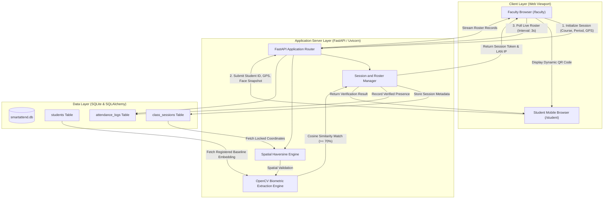
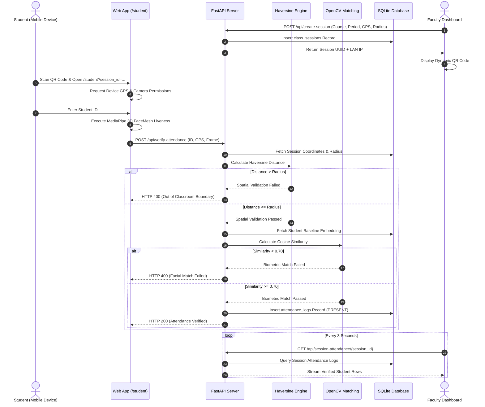
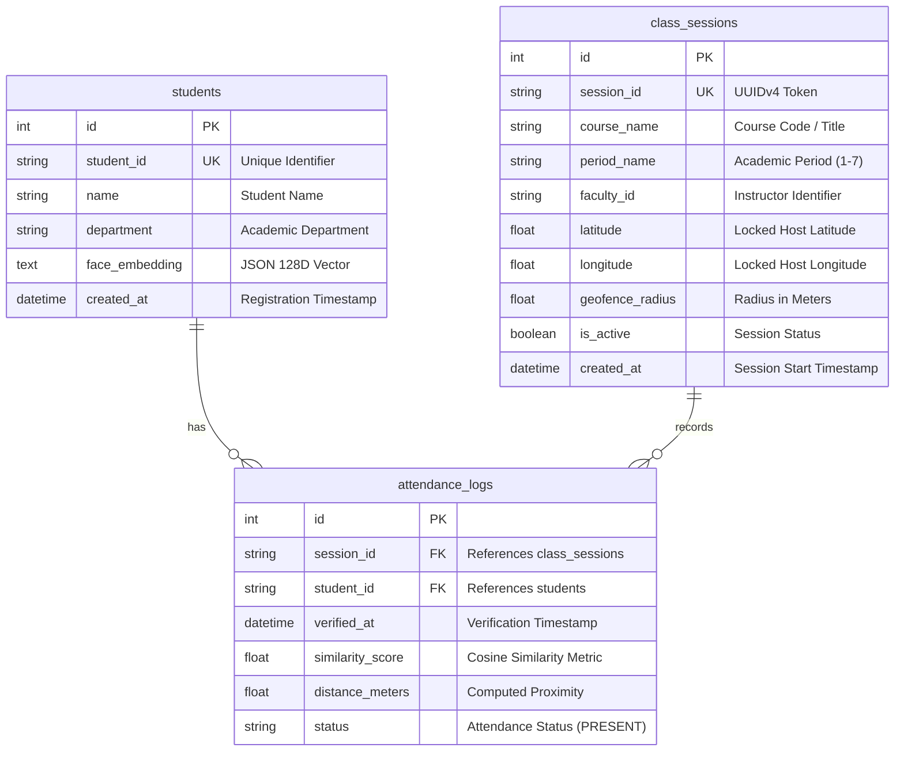

# SmartAttend AI System

### Production-Ready Zero-Proxy Biometric, Spatial and Period-Wise Attendance Verification Platform

<p align="center">
  
  
  
  
  
  
  
  
</p>

---

## Table of Contents

- [Project Overview](#project-overview)
- [Problem Statement](#problem-statement)
- [Project Objectives](#project-objectives)
- [Key Features](#key-features)
- [The Verification Triangle](#the-verification-triangle)
  - [Spatial Geofence Verification](#1-spatial-geofence-verification)
  - [3D Facial Liveness Detection](#2-3d-facial-liveness-detection)
  - [Biometric Identity Matching](#3-biometric-identity-matching)
- [System Architecture](#system-architecture)
- [Technology Stack](#technology-stack)
- [Project Folder Structure](#project-folder-structure)
- [Installation Requirements](#installation-requirements)
- [Installation and Setup Instructions](#installation-and-setup-instructions)
- [How to Run the Application](#how-to-run-the-application)
- [Application Modules](#application-modules)
  - [Faculty Dashboard](#1-faculty-dashboard-faculty)
  - [Student Registration](#2-student-registration-portal-register)
  - [Student Attendance Portal](#3-student-attendance-portal-student)
- [Step-by-Step Working Process](#step-by-step-working-process)
- [Attendance Verification Workflow](#attendance-verification-workflow)
- [Database Overview](#database-overview)
- [Report Generation and CSV Export](#report-generation-and-csv-export)
- [User Interface Screenshots](#user-interface-screenshots)
- [Future Enhancements](#future-enhancements)
- [Security and Privacy Considerations](#security-and-privacy-considerations)
- [License](#license)
- [Author Information](#author-information)

---

## Project Overview

SmartAttend AI System is an automated, zero-proxy period-wise attendance management platform engineered for academic institutions. The system operates directly through modern desktop and mobile web browsers without requiring specialized biometric scanners or native mobile application installations.

The platform couples spatial geofencing with computer vision techniques to eliminate attendance fraud, proxy check-ins, and manual roll-call inefficiencies. By validating student presence against a configurable classroom perimeter and verifying biometrics in real time, SmartAttend provides reliable, auditable, and period-specific attendance records.

---

## Problem Statement

Traditional academic attendance tracking systems suffer from persistent operational and integrity challenges:

- **Proxy Attendance (Buddy Punching):** Students sign roll sheets or submit digital tokens on behalf of absent peers.
- **Location Spoofing:** Static QR codes and check-in links are routinely captured and shared across messaging channels, allowing students to check in from remote locations.
- **Media Spoofing:** Conventional camera systems lacking liveness validation are easily deceived by printed photographs or digital screen replays.
- **Instructional Downtime:** Manual roll calls consume between 10 and 15 minutes of each lecture hour, reducing effective teaching time.
- **Absence of Period-Level Granularity:** General daily attendance does not track period-by-period presence, allowing students to skip individual lectures undetected.

---

## Project Objectives

- **Enforce Zero-Proxy Verification:** Implement a three-stage validation pipeline requiring physical proximity, liveness confirmation, and biometric matching.
- **Provide Period-Wise Tracking:** Support granular session creation across standardized academic periods (Period 1 through Period 7).
- **Ensure Zero Hardware Overhead:** Leverage standard mobile cameras and HTML5 Geolocation APIs to remove the need for dedicated biometric hardware scanners.
- **Automate Real-Time Auditing:** Enable live roster synchronization and downloadable CSV attendance reports containing comprehensive session and student metadata.

---

## Key Features

- **Period-Wise Session Scheduling:** Configure lecture sessions with specific course codes, academic periods, instructor identifiers, and geofence radii.
- **Dynamic LAN QR Code Resolution:** Automatically resolves the host server's local network IP address (`192.168.x.x`) to enable seamless mobile device connectivity over campus Wi-Fi.
- **Real-Time Live Polling:** Asynchronous polling updates the instructor dashboard roster every 3 seconds without requiring page refreshes.
- **Configurable Geofencing:** Flexible boundary enforcement ranging from strict classroom parameters (30 meters) to campus-wide or demonstration modes.
- **Master Student Directory:** Centralized institutional record tracking aggregate attendance metrics for all registered students.
- **Comprehensive CSV Exports:** Programmatic export of period-specific rosters and institutional master directories including timestamps, distance measurements, and similarity scores.

---

## The Verification Triangle

SmartAttend enforces verification through three independent, interdependent validation layers:

```
                            [ Verification Triangle ]

                             /                     \
                            /                       \
                           /                         \
                          /                           \
         [ 1. Spatial Geofence ] ----------------- [ 2. 3D Vitality Liveness ]
                          \                           /
                           \                         /
                            \                       /
                             [ 3. Biometric Match ]
```

### 1. Spatial Geofence Verification

Physical proximity between the instructor device and the student device is calculated using the spherical Haversine formula:

$$\Delta\phi = \text{radians}(\text{lat}_2 - \text{lat}_1)$$

$$\Delta\lambda = \text{radians}(\text{lon}_2 - \text{lon}_1)$$

$$a = \sin^2\left(\frac{\Delta\phi}{2}\right) + \cos(\phi_1)\cos(\phi_2)\sin^2\left(\frac{\Delta\lambda}{2}\right)$$

$$c = 2 \cdot \text{atan2}\left(\sqrt{a}, \sqrt{1 - a}\right)$$

$$d = R \cdot c$$

Where:
- $R = 6,371,000 \text{ meters}$ (Earth mean radius)
- $\phi_1, \lambda_1$: Instructor locked latitude and longitude
- $\phi_2, \lambda_2$: Student device latitude and longitude
- Validation condition: $d \le \text{Geofence Radius}$ (Default: $30.0 \text{ meters}$)

### 2. 3D Facial Liveness Detection

Client-side vitality verification is executed via Google MediaPipe FaceMesh directly in the browser:
- Tracks 468 three-dimensional facial landmark coordinates in real time.
- Verifies facial topology and continuous user engagement prior to frame transmission.
- Neutralizes static presentation attacks, including printed photos, video screen replays, and non-human surfaces.

### 3. Biometric Identity Matching

Server-side verification extracts and compares facial embeddings:
- **Preprocessing:** Grayscale conversion, center Region-of-Interest (ROI) cropping, and thumbnail scaling to $128 \times 128$ pixels.
- **Contrast Normalization:** Global histogram equalization via `cv2.equalizeHist`.
- **Feature Extraction:** An $8 \times 8$ spatial block grid computes localized mean and standard deviation descriptors, generating a 128-dimensional feature vector.
- **Normalization:** Vectors are $L_2$-normalized to unit length:

$$v_{\text{norm}} = \frac{v}{\|v\|_2}$$

- **Cosine Similarity Evaluation:** Compares the live vector $A$ against the stored baseline vector $B$:

$$\text{Similarity}(A, B) = \frac{A \cdot B}{\|A\|_2 \|B\|_2}$$

- **Validation Threshold:** Verification succeeds when similarity score is greater than or equal to $0.70$ ($70.0\%$).

---

## System Architecture



---

## Technology Stack

### Backend Technologies

| Technology | Version | Purpose |
| :--- | :--- | :--- |
| Python | 3.10+ | Core application and computational language |
| FastAPI | 0.110+ | Asynchronous REST API routing and request validation |
| Uvicorn | 0.28+ | High-performance ASGI web server |
| Pydantic | 2.0+ | Data parsing, schema validation, and serialization |

### Computer Vision and Mathematics

| Technology | Version | Purpose |
| :--- | :--- | :--- |
| OpenCV (`opencv-python`) | 4.8+ | Image decoding, contrast equalization, feature extraction |
| NumPy | 1.24+ | Vector operations, $L_2$-normalization, cosine distance math |
| Pillow (PIL) | 10.0+ | Image stream decoding and format conversions |
| MediaPipe FaceMesh | CDN | Real-time 3D facial landmark mesh detection |

### Persistence and Reporting

| Technology | Version | Purpose |
| :--- | :--- | :--- |
| SQLAlchemy | 2.0+ | Relational object-relational mapping (ORM) |
| SQLite 3 | Embedded | Zero-configuration persistence engine |
| ReportLab | 4.0+ | Programmatic PDF report generation engine |
| Python Standard `csv` | Built-in | RFC 4180-compliant CSV report synthesis |

### Frontend Technologies

| Technology | Version | Purpose |
| :--- | :--- | :--- |
| HTML5 / CSS3 | Modern | Semantic document structure and media capture |
| Tailwind CSS | 3.4 (CDN) | Responsive, utility-first design system |
| JavaScript | ES6+ | Asynchronous fetch calls, DOM updates, geolocation queries |
| QRCode.js | 1.0 (CDN) | Dynamic client-side QR code generation |
| FontAwesome | 6.4 (CDN) | Interface iconography |

---

## Project Folder Structure

```
SmartAttend-AI/
├── main.py                                  # FastAPI application, API routes, verification engine
├── database.py                              # SQLAlchemy models, SQLite connection, schema initialization
├── requirements.txt                         # Python runtime dependencies
├── .gitignore                               # Git ignored files and directories
├── README.md                                # Project documentation
├── templates/                               # Jinja2 presentation templates
│   ├── faculty.html                         # Instructor session control and real-time roster portal
│   ├── index.html                           # Student mobile verification portal
│   └── register.html                        # Student baseline facial enrollment portal
└── SmartAttend_Project_Documentation.docx   # Academic and technical documentation
```

---

## Installation Requirements

- **Operating System:** Windows 10/11, Ubuntu 20.04+, or macOS 12+
- **Python Runtime:** Python 3.10, 3.11, or 3.12
- **Package Manager:** `pip` (Python Package Index)
- **Browser Compatibility:** Google Chrome 90+, Microsoft Edge 90+, Mozilla Firefox 90+, or Safari 14+
- **Hardware Peripherals:** Web camera (laptop integrated or external) and GPS-capable mobile device

---

## Installation and Setup Instructions

### 1. Clone the Repository

```bash
git clone https://github.com/sudharshana-senthil/SmartAttend-AI.git
cd SmartAttend-AI
```

### 2. Create and Activate a Virtual Environment

#### Windows (PowerShell)

```powershell
python -m venv venv
.\venv\Scripts\Activate.ps1
```

#### Windows (Command Prompt)

```cmd
python -m venv venv
.\venv\Scripts\activate.bat
```

#### Linux / macOS

```bash
python3 -m venv venv
source venv/bin/activate
```

### 3. Install Required Dependencies

```bash
pip install --upgrade pip
pip install -r requirements.txt
```

---

## How to Run the Application

Execute the Uvicorn ASGI server from the project root directory:

```bash
python -m uvicorn main:app --host 0.0.0.0 --port 8000 --reload
```

Upon initialization, the console displays:

```text
INFO:     Uvicorn running on http://0.0.0.0:8000 (Press CTRL+C to quit)
INFO:     Started server process
INFO:     Waiting for application startup.
INFO:     Application startup complete.
```

### Application Portals

Open your web browser and navigate to:

| Portal | URL | Description |
| :--- | :--- | :--- |
| Faculty Dashboard | `http://localhost:8000/faculty` | Session creation, dynamic QR display, live roster |
| Student Registration | `http://localhost:8000/register` | Student baseline face registration |
| Student Portal | `http://localhost:8000/student` | Mobile attendance verification |
| API Documentation | `http://localhost:8000/docs` | Interactive OpenAPI Swagger UI |

---

## Application Modules

### 1. Faculty Dashboard (`/faculty`)
- Requests browser location permission to lock host latitude and longitude.
- Captures Course Name, Academic Period (Period 1 to Period 7), Instructor ID, and Geofence Radius.
- Displays a dynamically generated QR code pointing to the host machine's local network address.
- Provides a dual-tab table for monitoring active class check-ins and the master student directory.
- Features dedicated export actions for period-specific CSVs and institutional master summaries.

### 2. Student Registration Portal (`/register`)
- Onboards students with Student ID, Full Name, and Academic Department.
- Interfaces with the webcam to capture a baseline portrait.
- Computes and serializes the 128-dimensional facial embedding into the `students` table.

### 3. Student Attendance Portal (`/student`)
- Receives the session token via QR code URL parameters.
- Prompts for student identification and initiates device GPS location queries.
- Runs the MediaPipe 3D FaceMesh liveness verification challenge.
- Submits the spatial and visual payload to the server for triangle validation.

---

## Step-by-Step Working Process

1. **Baseline Registration:** Student registers once at `/register`. The server stores their identification details and baseline facial embedding.
2. **Session Launch:** Instructor accesses `/faculty`, enters lecture metadata, selects the current period, and initiates the session.
3. **Location Lock:** The application captures the instructor's exact GPS coordinates and establishes the geofence perimeter.
4. **QR Code Broadcast:** The server identifies its LAN IP (`http://192.168.x.x:8000/student?session_id=<UUID>`) and projects the QR code.
5. **Student Scan:** Students scan the QR code using mobile devices connected to the campus network.
6. **Triple Validation:**
   - Spatial engine verifies student distance $\le$ configured radius.
   - Client verifies liveness using facial mesh landmarks.
   - Server computes cosine similarity between live frame and baseline vector.
7. **Attendance Recording:** If all three layers pass, attendance status is marked `PRESENT`.
8. **Dashboard Synchronization:** The instructor's live roster refreshes automatically every 3 seconds to reflect the verified record.

---

## Attendance Verification Workflow



---

## Database Overview

The platform uses SQLAlchemy ORM mapped to an SQLite relational database (`smartattend.db`).



### Table Definitions

#### `students`
Stores permanent identity records and serialized facial embeddings.
- `student_id`: Primary business key (Indexed, Unique).
- `face_embedding`: Serialized JSON array of 128 floating-point coefficients.

#### `class_sessions`
Stores individual lecture session instances.
- `session_id`: Unique UUIDv4 string token.
- `period_name`: Academic period label (`Period 1` through `Period 7`).
- `latitude` / `longitude`: Baseline instructor coordinates.
- `geofence_radius`: Enforcement threshold in meters.

#### `attendance_logs`
Stores verified attendance transactions.
- Enforces composite uniqueness: `UniqueConstraint("session_id", "student_id")` to prevent duplicate submissions within the same session.

---

## Report Generation and CSV Export

The system provides automated reporting options accessible directly from the dashboard:

### 1. Active Period CSV Export (`/api/export-attendance/{session_id}`)
Generates a downloadable CSV containing attendance records for the active lecture session.

```csv
SmartAttend Verification Report - Period Attendance
Staff / Faculty Name:,swathi
Course Name:,computer network
Period Name:,Period 2
Session UUID:,fc46c9f7-ef5a-46e6-85e9-e05cb0d41d6d
Generated At:,2026-11-22 08:30:00 UTC

Student ID,Student Name,Department,Staff / Faculty Name,Course Name,Period Name,Verified At,Similarity Score (%),Distance (m),Status
2025MCA53,Sudharshana K S,MCA,swathi,computer network,Period 2,2026-11-22 08:35:12,75.1,0.0,PRESENT
```

### 2. Institutional Master Directory CSV (`/api/export-master-attendance`)
Compiles institutional metrics across all registered students, documenting total attended sessions, recent course/period check-ins, and overall status.

---

## User Interface Screenshots

### Faculty Control Dashboard
```
+----------------------------------------------------------------------------------------------------+
|  SmartAttend Faculty Session Control                                           [Dashboard] [Register] |
+------------------------------------+---------------------------------------------------------------+
|  Start New Class Session           |  Live Verification Roster             Total Verified: 1 [CSV] |
|                                    |  [Active Class Session]  [Master Directory]                   |
|  COURSE NAME / CODE                +---------------------------------------------------------------+
|  [ computer network              ] |  STUDENT ID   NAME         DEPT  STAFF   COURSE  PERIOD  STATUS  |
|  PERIOD NAME / NUMBER              |  2025MCA53    Sudharshana  MCA   swathi  CN      Per 2   PRESENT |
|  [ Period 2 (10:00 AM - 11:00 AM)] |                                                               |
|  FACULTY ID / INSTRUCTOR NAME      |                                                               |
|  [ swathi                        ] |                                                               |
|  GEOFENCE RADIUS BOUNDARY          |                                                               |
|  [ 30 Meters (Strict Classroom)  ] |                                                               |
|                                    |                                                               |
|  [ 1-Click Start Session ]         |                                                               |
+------------------------------------+---------------------------------------------------------------+
```

### Student Mobile Verification Portal
```
+----------------------------------------------------------------------------------------------------+
|                                    SmartAttend Student Portal                                      |
+----------------------------------------------------------------------------------------------------+
|                 [1. Spatial (30m)]   [2. 3D Vitality Liveness]   [3. Identity (70%)]               |
+----------------------------------------------------------------------------------------------------+
|  Attendance Log                    |  Camera Viewport                                              |
|  REGISTERED STUDENT ID             |  +---------------------------------------------------------+  |
|  [ 2025MCA53                     ] |  |                                                         |  |
|                                    |  |                  [ Live Face Mesh ]                     |  |
|  Classroom Distance: 0.0 m         |  |                                                         |  |
|  Liveness: Face Centered           |  +---------------------------------------------------------+  |
|                                    |                                                               |
|  [ Begin Verification Triangle ]   |  Status: Attendance Verified & Recorded Successfully!         |
+------------------------------------+---------------------------------------------------------------+
```

---

## Future Enhancements

- **Learning Management System (LMS) Integration:** LTI-compliant connectors for Moodle, Canvas, and Blackboard.
- **Automated Absence Notification:** Webhook-driven email and SMS alerting to notify guardians of unexcused period absences.
- **Multi-Camera Hallway Validation:** RTSP stream integration for passive verification across large lecture auditoriums.
- **Offline Mesh Synchronization:** Progressive Web App (PWA) offline queuing for environments with intermittent network coverage.

---

## Security and Privacy Considerations

- **No Raw Biometric Storage:** The system does not persist raw student facial photographs. Only mathematical 128-dimensional floating-point vectors are retained.
- **Anti-Replay Mechanism:** Attendance submissions require active session UUIDs that are validated against active timestamps.
- **Ephemeral QR Links:** QR codes encode dynamic session endpoints that expire when the faculty session is terminated.
- **Browser Cache Invalidation:** Critical endpoints return `Cache-Control: no-cache, no-store, must-revalidate` headers to prevent credential and state leakage.

---

## License

This project is distributed under the MIT License. See `LICENSE` for further details.

---

## Author Information

- **Developer:** Sudharshana Senthil
- **Institution:** Department of Computer Applications
- **Repository:** [https://github.com/sudharshana-senthil/SmartAttend-AI](https://github.com/sudharshana-senthil/SmartAttend-AI)
- **Project Name:** SmartAttend AI System
